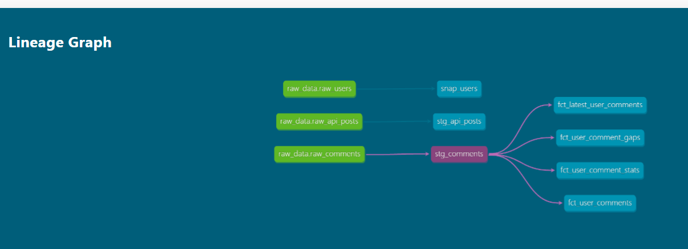

# 🚀 Enterprise Resilient Data Pipeline & Analytics Stack

An end-to-end Data Engineering pipeline built with Python, DuckDB, dbt Core, and Apache Airflow.
The system ingests raw data from REST APIs using dynamic pagination and exponential backoff retries, stores it in an analytical columnar database (DuckDB), and executes layered SQL transformations (Staging, Marts, Snapshots) with automated data quality testing.

Airflow schedules the work, retries a failed step, and keeps the tasks in order. `python run_pipeline.py` runs the same sequence in one process when you want a local fallback without starting Airflow.

---

## 🏗️ Architecture & Data Lineage

```
┌──────────────────────────────────────────────────────────────┐
│ Orchestration                                                │
│  • Airflow Dag `enterprise_data_pipeline` (@daily)           │
│  • Local fallback: `python run_pipeline.py`                  │
└────────────┬─────────────────────────────────────────────────┘
             │ ingest comments+users, then posts
             ▼
┌─────────────────────────┐
│ Dynamic REST APIs       │
│ JSONPlaceholder         │
└────────────┬────────────┘
             │ Python (Requests / Retry Logic)
             ▼
┌─────────────────────────┐
│ DuckDB (Analytical DW)  │
│ dev.duckdb              │
└────────────┬────────────┘
             │ dbt snapshot → dbt run → dbt test
             ▼
┌─────────────────────────────────────────────────────────────┐
│  • Staging Models (Casting, Cleaned Strings via Jinja)      │
│  • Snapshots (SCD Type 2 Change Data Capture)               │
│  • Marts (Window Functions, LAG Gaps, Deduplication)        │
└─────────────────────────────────────────────────────────────┘
```

### 📍 dbt Lineage Graph (DAG)


---

## 🛠️ Key Architectural Features

1. **Resilient API Ingestion (`ingest_api_resilient.py`):**
   - Dynamic pagination handling (`while True`).
   - Rate Limit management (HTTP 429 via `Retry-After` header).
   - Exponential Backoff algorithm ($2^{\text{attempt}}$) for transient network glitches.
   - Atomic loading to DuckDB.

2. **Modular dbt Data Modeling:**
   - **Staging Layer (Silver):** Standardizes schemas, performs type casting, and applies custom Jinja macros (`clean_string`).
   - **SCD Type 2 Snapshot (`snap_users`):** Tracks user dimension updates over time using validity timestamps (`dbt_valid_from`, `dbt_valid_to`).
   - **Marts Layer (Gold):** Employs advanced SQL window functions (`LAG()`, `ROW_NUMBER()`, `COUNT() OVER()`) for event sequencing, deduplication, and gap analysis.

3. **Data Governance & Automated Quality Testing:**
   - Schema enforcement via `_sources.yml`.
   - Test coverage (`unique`, `not_null`) on the mart models, running on every pipeline execution.

4. **Orchestration:**
   - **Airflow** (`dags/enterprise_data_pipeline.py`): daily schedule, task dependencies, and retries. The comments in that file explain why the tasks are serial, why ingestion is retried, why tests are not, and how dbt is invoked.
   - **Local fallback** (`run_pipeline.py`): the same five steps in one process, with execution timing and strict exception handling (`check=True`).
   - Every step is safe to run again. The ingest scripts replace their raw tables, `dbt run` rebuilds views and tables, the snapshot records a new version only when a tracked column changed, and `dbt test` only reads.

---

## 🚀 Quick Start Guide

### Prerequisites
- Python 3.10+
- Docker with Docker Compose v2, for the Airflow UI. The local fallback needs only Python.

The ingest scripts call the public [JSONPlaceholder](https://jsonplaceholder.typicode.com) API, so the machine running the pipeline needs outbound network access.

### 1. Clone the repository

```bash
git clone https://github.com/yishaimoskovitz-dotcom/enterprise-data-pipeline.git
cd enterprise-data-pipeline
```

### 2. Local fallback (no Airflow)

```bash
python -m venv .venv
source .venv/bin/activate
pip install -r requirements.txt
python run_pipeline.py
```

On Windows PowerShell, activate with `.venv\Scripts\Activate.ps1`.

That command runs, in order:

1. `ingest_comments.py` loads users and comments into DuckDB.
2. `ingest_api_resilient.py` loads posts, with pagination and retries.
3. `dbt snapshot` builds the SCD2 user snapshot (`snap_users`).
4. `dbt run` builds the staging views and mart tables.
5. `dbt test` runs the schema tests.

dbt looks for `~/.dbt/profiles.yml` by default. This repo ships `profiles.yml` in the project root (a local `dev.duckdb` file, no passwords). `run_pipeline.py` passes `--profiles-dir .`, so a clean checkout does not need a profile copied into your home directory. To run a single dbt command yourself:

```bash
dbt run --project-dir . --profiles-dir .
```

The same fallback, with dependencies already installed in the image:

```bash
docker build -t enterprise-data-pipeline .
docker run --rm enterprise-data-pipeline
```

### 3. Airflow with Docker Compose

`docker-compose.yml` starts Airflow 3.4 with Postgres, the API server (the UI), the scheduler, and the Dag processor. The image is `Dockerfile.airflow`: the official Airflow image plus `requirements.txt`, so the scheduler can run `python` and `dbt`.

The executor is **LocalExecutor**. DuckDB is one file with a single writer, and LocalExecutor runs the tasks on the scheduler, next to the mounted repo. The UI login and the Postgres password in the compose file are local demo values.

```bash
# Linux: match the container user to yours so it can write dev.duckdb into the repo.
echo "AIRFLOW_UID=$(id -u)" > .env
# Docker Desktop on macOS or Windows can skip that. The default uid is 50000.

docker compose build
docker compose up
```

Open [http://localhost:8080](http://localhost:8080) and sign in with `airflow` / `airflow`.

The Dag is paused the first time it is parsed, so cloning the repo does not call the API. Unpause `enterprise_data_pipeline` and trigger it. After that it also runs on the `@daily` schedule (00:00 UTC).

Stop the stack with Ctrl+C, then:

```bash
docker compose down
```

### 4. Airflow standalone (no Docker)

`airflow standalone` starts the scheduler, Dag processor, triggerer, and API server in one terminal, with a local SQLite metadata database. Airflow 3.4 needs Python 3.11 or newer. Install it with the constraint file that matches your Python version (`constraints-3.11.txt`, `constraints-3.12.txt`, or `constraints-3.13.txt`), then install the pipeline libraries in the same virtualenv. The scheduler is the process that runs `dbt` and the ingest scripts. The commands below use Python 3.12.

```bash
python -m venv .venv
source .venv/bin/activate
pip install "apache-airflow==3.4.0" --constraint "https://raw.githubusercontent.com/apache/airflow/constraints-3.4.0/constraints-3.12.txt"
pip install -r requirements.txt

export AIRFLOW_HOME="$(pwd)/.airflow"
export AIRFLOW__CORE__DAGS_FOLDER="$(pwd)/dags"
export AIRFLOW__CORE__LOAD_EXAMPLES=False
export PIPELINE_PROJECT_DIR="$(pwd)"
airflow standalone
```

The first launch prints a password for the `admin` user and writes it to `.airflow/simple_auth_manager_passwords.json.generated`. The UI is at [http://localhost:8080](http://localhost:8080). Unpause and trigger `enterprise_data_pipeline` the same way as in the Docker setup.

Why each task, retry, and dbt flag is set the way it is: `dags/enterprise_data_pipeline.py`.
