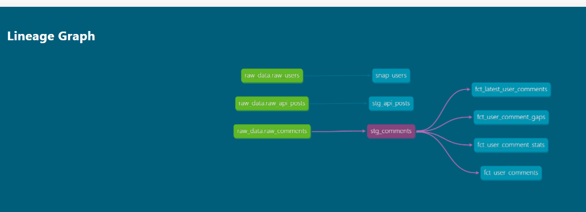

# 🚀 Enterprise Resilient Data Pipeline & Analytics Stack

An end-to-end Data Engineering pipeline built with Python, DuckDB, and dbt Core. 
The system ingests raw data from REST APIs using dynamic pagination and exponential backoff retries, stores it in an analytical columnar database (DuckDB), and executes layered SQL transformations (Staging, Marts, Snapshots) with automated data quality testing.

---

## 🏗️ Architecture & Data Lineage

```
┌─────────────────────────┐
│ Dynamic REST APIs       │
└────────────┬────────────┘
             │ Python (Requests / Retry Logic)
             ▼
┌─────────────────────────┐
│ DuckDB (Analytical DW)  │
└────────────┬────────────┘
             │ dbt Core Transformations
             ▼
┌─────────────────────────────────────────────────────────────┐
│  • Staging Models (Casting, Cleaned Strings via Jinja)      │
│  • Snapshots (SCD Type 2 Change Data Capture)               │
│  • Marts (Window Functions, LAG Gaps, Deduplication)        │
└─────────────────────────────────────────────────────────────┘
```

### 📍 dbt Lineage Graph (DAG)


---

## 🛠️ Key Architectural Features

1. **Resilient API Ingestion (`ingest_api_resilient.py`):**
   - Dynamic pagination handling (`while True`).
   - Rate Limit management (HTTP 429 via `Retry-After` header).
   - Exponential Backoff algorithm ($2^{\text{attempt}}$) for transient network glitches.
   - Atomic loading to DuckDB.

2. **Modular dbt Data Modeling:**
   - **Staging Layer (Silver):** Standardizes schemas, performs type casting, and applies custom Jinja macros (`clean_string`).
   - **SCD Type 2 Snapshot (`snap_users`):** Tracks user dimension updates over time using validity timestamps (`dbt_valid_from`, `dbt_valid_to`).
   - **Marts Layer (Gold):** Employs advanced SQL window functions (`LAG()`, `ROW_NUMBER()`, `COUNT() OVER()`) for event sequencing, deduplication, and gap analysis.

3. **Data Governance & Automated Quality Testing:**
   - Schema enforcement via `_sources.yml`.
   - Comprehensive test coverage (`unique`, `not_null`, `relationships`) running on every pipeline execution.

4. **Production Orchestration (`run_pipeline.py`):**
   - Unified Python orchestrator managing execution order via `subprocess`.
   - Built-in execution timing and strict exception handling (`check=True`).

---

## 🚀 Quick Start Guide

### Prerequisites
- Python 3.10+
- Docker (optional)

### Local Setup & Execution
1. **Clone the repository:**
   ```bash
   git clone [https://github.com/your-username/my-data-pipeline.png.git](https://github.com/your-username/my-data-pipeline.png.git)
   cd my-data-pipeline
   ```

2. **Install dependencies:**
   ```bash
   pip install pandas duckdb dbt-duckdb requests
   ```

3. **Run the full end-to-end pipeline:**
   ```bash
   python run_pipeline.py
   ```